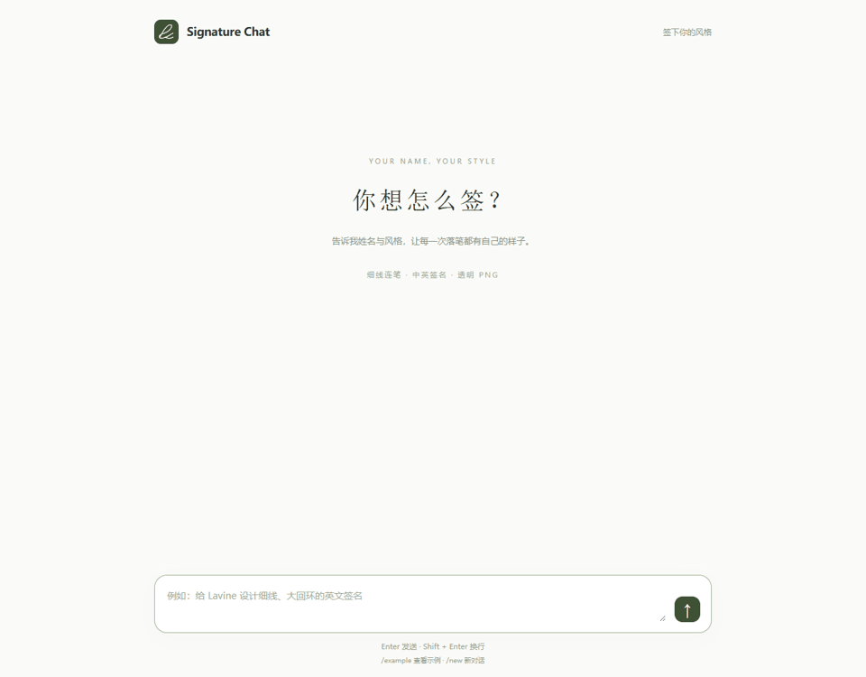
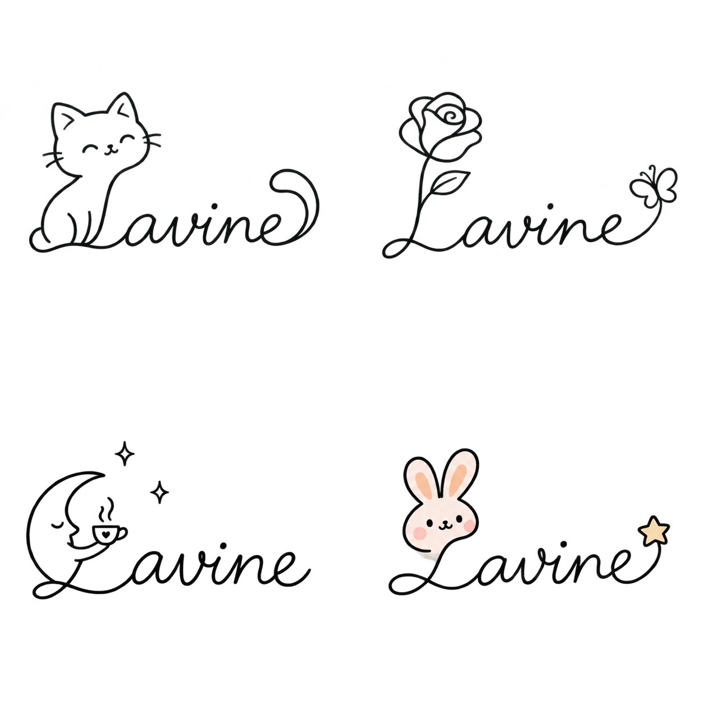

[中文](README.md) | [English](README.en.md)

<p align="center"></p>
<h1 align="center">Signature Chat</h1>
<p align="center">One conversation for signature design. Every download is a transparent PNG.</p>

A Vue 3 + Vite frontend with a local Python API. Describe names and styles, refine them conversationally, and view the results in the same chat. No Codex installation or skill directory is required.



The animation records the actual Vue application selecting a real welcome-screen example, using the `@` style picker, and entering a name. It is not a live image-generation recording and does not fabricate API calls.

## Features

- One text box for names, languages, style requirements, and follow-up changes.
- Three lettering directions (legible, ornamental loops, angular fast autographs) plus four illustrated styles: cute pets, botanical details, celestial doodles, and pastel characters.
- **Transparent PNG downloads**: request transparency, process ink locally or preserve pastel colors, and export only RGBA PNGs with verified transparent pixels.
- The checkerboard is a preview background and is never exported.
- SQLite stores conversations, statuses, and actual dimensions; refresh to resume viewing.
- Request IDs prevent duplicate calls. No automatic generation retries. Interrupted jobs are marked on restart.
- Credentials stay in the server environment, never in the browser, database, or source.

## Requirements

Python 3.12+, Node.js 22.12+, and npm. Local builds and interactions have been checked on Windows with Python 3.12, Node 24, and Edge. Other operating systems require their own validation.

## Quick start

Run from the repository root. Windows PowerShell:

```powershell
py -3.12 -m venv venv-3.12
npm --prefix frontend ci
npm --prefix frontend run build
& .\venv-3.12\Scripts\python.exe -m pip install -e .
$env:C2A_API_KEY = 'YOUR_API_KEY'
& .\venv-3.12\Scripts\signature-chat.exe serve
```

## Usage

Ask for “a large-loop English signature for Lavine,” then “shorten the finishing stroke and show only one design.” Enter sends; Shift + Enter inserts a newline.

The welcome screen includes ten real signature examples. Clicking one inserts only a short style title, preserving your name and custom text. Detailed drawing rules are expanded on the server. A title alone prompts you to enter a name without generating or charging.

Type `@` to open the style picker, then type a keyword such as `loop` to filter. Use ↑ / ↓, Enter to select, Esc to dismiss, or click an option. Enter selects without sending while the picker is open. Only the style title is inserted into the message; choosing another style replaces the previous selection.

- `/example`: show a real local example without a paid request.
- `/new`: start a new conversation; older records remain in the local database.
- “下载透明 PNG”: download the transparent result at its actual dimensions.

Follow-up text produces a new image from the accumulated instructions, not a precise pixel edit. This is an artistic lettering tool, not a digital-signature or identity-verification system.

## Transparent export

For **black ink on a white or transparent canvas**, the matte estimates ink opacity from inverse luminance and multiplies it by the existing alpha. It preserves soft stroke edges, removes near-white noise, and sets RGB to black. Export checks require transparent pixels and meaningful ink; otherwise no output is delivered.

Selecting the pastel style or explicitly asking for pastel accents enables color-preserving export. Native transparent images keep their RGB and alpha; opaque white images use a near-white removal fallback that retains color fills and reduces white edges. A later “black and white” request switches back to monochrome processing.

This is not general background removal. Photos, shadows, and textured backgrounds are unsupported. Very pale, near-white fills may become transparent in the white-background fallback; native transparent output is preferred.

Offline conversion is available:

```bash
signature-chat transparent input.png output-transparent.png
# Preserve pastel illustration colors
signature-chat transparent pastel.png pastel-transparent.png --preserve-color
```

The source is preserved and the output must be a new `.png` file.



Type `@pet`, `@flower`, `@moon`, or `@pastel` to select an illustrated style. Add instructions such as “replace the kitten with a bunny.” Names and motifs are regenerated from the full text context. Reference photos informed style analysis only; published examples are newly generated original compositions.


[Transparent bilingual example](assets/bilingual-transparent.png) · [Asset provenance](assets/PROVENANCE.md)

## Configuration and data

```bash
signature-chat serve --port 8780 --data-dir ./data --model gpt-image-2
```

`gpt-image-2.5-flare` and `gpt-image-2.5-sunburst` are selectable; their presence does not imply individual live testing in this repository. Override the top-level model with `C2A_MAIN_MODEL`.

Default storage is `.signature-chat/` under the current user's home, containing SQLite and transparent images. Browser localStorage keeps only the conversation ID and unresolved submission text, never credentials. Prompts are sent to C2A. The server listens on `127.0.0.1` for local single-user use; public account management is not included.

Socket reads time out after 30 seconds. A 180-second overall budget is checked between chunks, so the last read may add one timeout interval. Interrupted requests may still incur charges; no automatic generation retry occurs.

## Development and validation

```bash
# Terminal 1: Python API
signature-chat serve
# Terminal 2: Vue dev server, proxying to port 8780
npm --prefix frontend run dev
# Offline tests and packaging
python -m unittest discover -s tests -v
npm --prefix frontend run build
python -m pip install build
python -m build
```

Vue source lives in `frontend/src/`. Vite builds to `src/signature_chat/web/`, included in the wheel; build the frontend before installing from source. Backend layers are `core/`, `infra/`, and `services/`. CI checks the Vue build, offline tests, and Python packages.

Offline validation is not a new paid end-to-end API test. Showcase images came from actual earlier C2A calls; the adapter is additionally checked by replaying a real historical response locally, not by fabricating model output.

## License

Project code and the original SVG mark use [MIT](LICENSE). Showcase images are AI-generated original lettering concepts using user-specified names, processed locally for transparency. They are not authentic celebrity autographs or endorsements; Chinese and English names are layout examples, not translations. Dependencies retain their upstream licenses. C2A is an external service.
