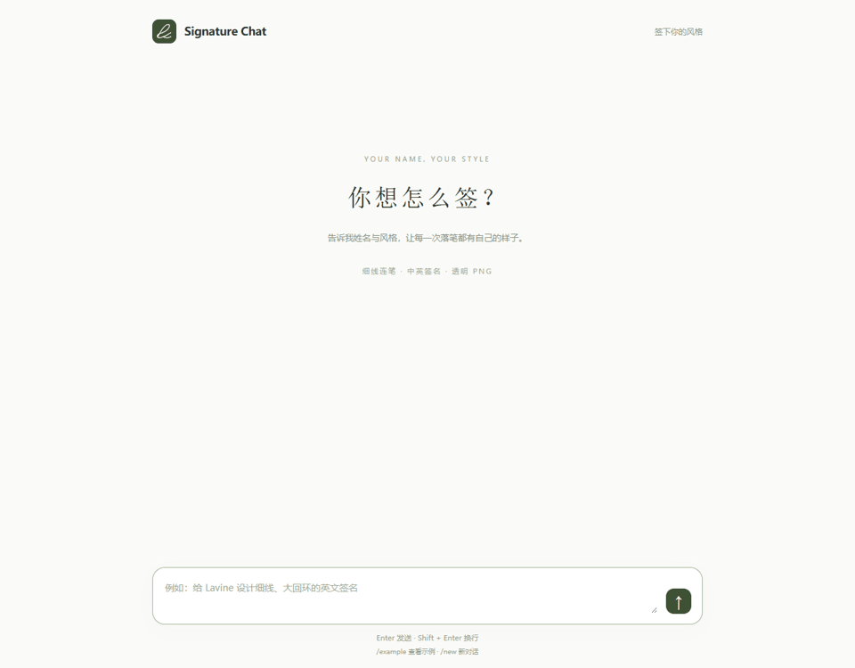
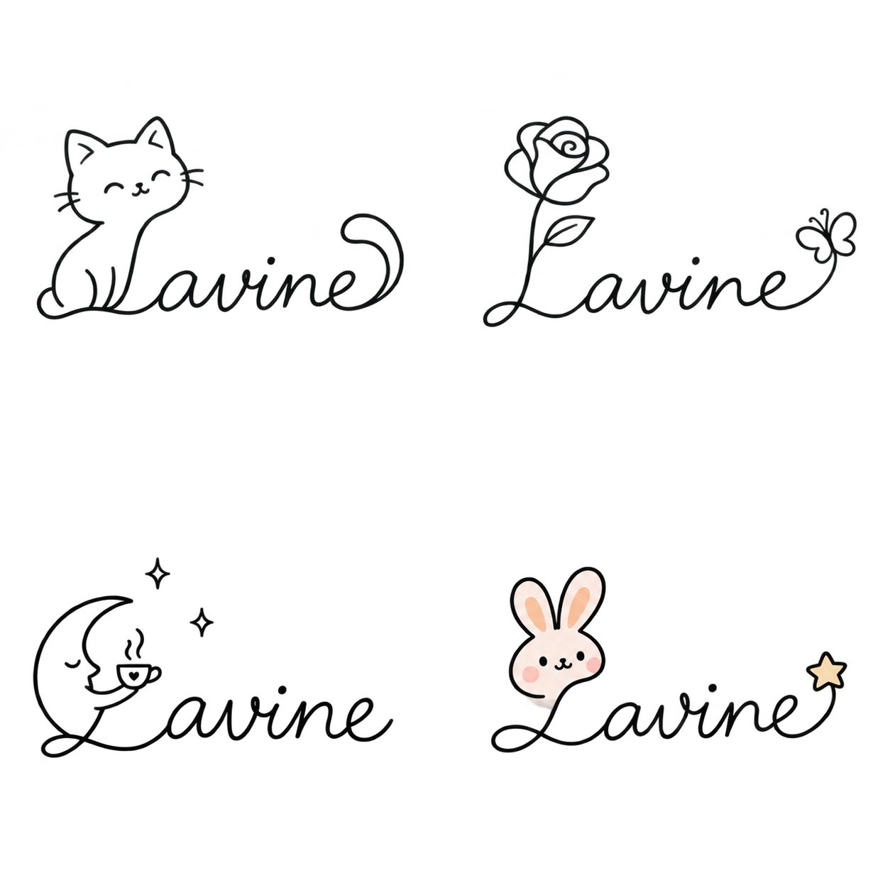

[中文](README.md) | [English](README.en.md)

<p align="center"></p>
<h1 align="center">Signature Chat</h1>
<p align="center">一个对话框，设计你的签名。所有下载均为透明 PNG。</p>

Vue 3 + Vite 前端，Python 本地 API。输入姓名和风格，继续用自然语言修改，结果在同一对话里展示。无需安装 Codex 或任何技能目录。



动图录制的是实际 Vue 页面：点击首页真实案例、输入 `@` 选择风格，并填写姓名。它不是实时生图录屏，不展示虚构的接口调用。

## 功能

- 单对话框：姓名、语言和风格均通过文字描述，支持多轮修改。
- 三种连笔方向：简洁易读、回环花式、利落速签；新增萌宠线描、花植点缀、星月童话、淡彩萌系四类图案签名。
- **透明 PNG 导出**：请求透明背景，并在本地处理笔迹或保留淡彩；只有包含真实透明像素的 RGBA PNG 才可下载。
- 棋盘格仅用于预览，不会进入导出文件。
- SQLite 保存对话、状态和真实尺寸；刷新后继续查看。
- 相同请求编号不会重复调用；超时和失败不自动重试，程序重启后标记中断任务。
- 凭证仅来自服务端环境变量，不发送到浏览器、不写入数据库或源码。

## 运行环境

Python 3.12+、Node.js 22.12+、npm。已在 Windows、Python 3.12、Node 24 和 Edge 上验证本地构建与交互。其他操作系统的运行情况以实际测试为准。

## 快速开始

在项目根目录运行。Windows PowerShell：

```powershell
py -3.12 -m venv venv-3.12
npm --prefix frontend ci
npm --prefix frontend run build
& .\venv-3.12\Scripts\python.exe -m pip install -e .
$env:C2A_API_KEY = 'YOUR_API_KEY'
& .\venv-3.12\Scripts\signature-chat.exe serve
```

macOS / Linux 的对应命令（未在本次本机验收中实测）：

```bash
python3.12 -m venv venv-3.12
npm --prefix frontend ci
npm --prefix frontend run build
venv-3.12/bin/python -m pip install -e .
export C2A_API_KEY='YOUR_API_KEY'
venv-3.12/bin/signature-chat serve
```

打开 <http://127.0.0.1:8780>。首次不配置密钥也能查看 `/example` 真实样例和测试透明下载；实际生成需要有效凭证。不要把密钥写入前端或提交到 Git。

默认接口为 `https://c2a.jiaopilot.com/v1/responses`，图像工具模型为 `gpt-image-2`，顶层模型默认 `gpt-6.1-sol`。这不是官方 OpenAI API 端点；需使用该服务的凭证，价格和可用性由服务端决定。

## 使用

输入“给 Lavine 设计一个大回环的英文签名”，再输入“收笔短一点，只保留一款”。按 Enter 发送，Shift + Enter 换行。

首页提供十个真实签名案例，点击只填入【模式标题】，保留已输入的姓名与要求，不会自动生成或扣费。详细绘制规则由后台补全；只有模式标题时会提示填写姓名。

输入 `@` 打开风格菜单，可继续输入“花式”等关键词筛选。用 ↑ / ↓ 移动、Enter 选择、Esc 关闭，也支持鼠标点击。选择风格时的 Enter 不会发送消息；输入框仅显示模式标题，详细规则由后台展开，再次选择会替换此前的风格。

- `/example`：查看本地真实样例，不发起付费请求。
- `/new`：开始新对话，旧记录仍保留在本机数据库。
- 点击“下载透明 PNG”获取原尺寸透明结果。

文字描述会作为上下文重新生成图片，并非精确编辑上一张图片。程序提供艺术签名设计，不提供电子签章或身份认证。

## 透明导出

算法针对**黑色笔迹、白底或透明底**：用反向亮度估计笔迹透明度，再与已有 alpha 相乘，保留细线抗锯齿，去除近白噪点，最终 RGB 为黑色。导出前检查透明像素和有效笔迹；不满足则不导出。

选择「淡彩萌系」或明确要求淡彩时，自动启用保色导出：原生透明图保持原有颜色和alpha；白底回退去除近白背景、保留彩色填充并处理边缘白边。后续要求“改为黑白”会切回黑色笔迹模式。

这不是通用抠图：照片、阴影和纹理背景不适用；白底保色回退可能使极浅的近白填充变透明，优先使用服务端原生透明输出。

也可以离线处理已有黑白签名图：

```bash
signature-chat transparent input.png output-transparent.png
# 淡彩插画保色导出
signature-chat transparent pastel.png pastel-transparent.png --preserve-color
```

输入不会被覆盖，输出必须是新 `.png` 文件。



在输入框输入 `@萌宠`、`@花植`、`@星月` 或 `@淡彩` 选择对应风格。也可追加“把小猫换成兔子”等要求，姓名和图案会依据完整文字重新生成。参考照片仅用于分析风格；公开案例为本项目真实新生成的原创构图。


[中英文对照透明原图](assets/bilingual-transparent.png) · [素材来源说明](assets/PROVENANCE.md)

## 配置与数据

```bash
signature-chat serve --port 8780 --data-dir ./data --model gpt-image-2
```

支持选择 `gpt-image-2.5-flare`、`gpt-image-2.5-sunburst`。这些选项不代表本仓库已对其逐个进行调用测试。`C2A_MAIN_MODEL` 可覆盖顶层模型。

默认数据位于用户主目录的 `.signature-chat/`，包含数据库和透明图片。网页仅在 localStorage 保存对话编号和未确认提交的文本，绝不保存密钥。请求内容会发送给 C2A。连接只监听 `127.0.0.1`；此版本用于单用户本地运行，没有公网账户体系。

网络读取超时30秒，整体读取预算180秒，并在分块读取之间检查，因此可能多等待一个读取周期。中断可能已产生费用；不会自动重发。

## 开发与验证

```bash
# 终端1：Python API
signature-chat serve
# 终端2：Vue开发服务器（代理到8780）
npm --prefix frontend run dev
# 离线测试与构建
python -m unittest discover -s tests -v
npm --prefix frontend run build
python -m pip install build
python -m build
```

前端源码位于 `frontend/src/`。Vite 生产输出位于 `src/signature_chat/web/`，随 wheel 打包；从源码安装前先构建前端。后端按 `core/`、`infra/`、`services/` 分层。CI 检查 Vue 构建、离线测试和 Python 打包。

本地离线验收不等于新适配器的付费联网端到端验证。展示图片来自此前真实的 C2A 生成结果；当前实现另以真实历史响应做离线回放检查，不伪造模型结果。

## 许可证

项目代码与原创 SVG 标识采用 [MIT](LICENSE)。展示图是用户指定姓名的 AI 原创设计示例，经本地透明处理，不是相关人士本人真实签名或背书；中英姓名仅为排版对照。依赖分别保留其上游许可证，C2A 为外部服务。
